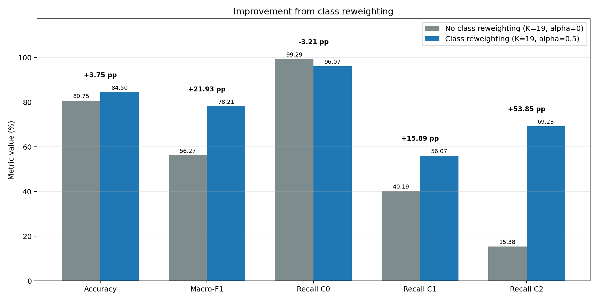
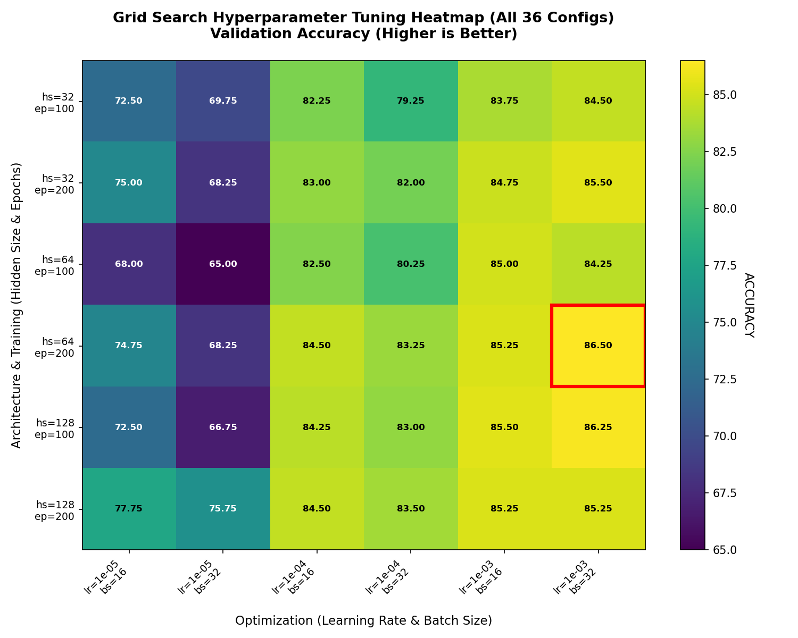

# Gaming Addiction Prediction: Machine Learning from Scratch

Predicting gaming addiction level (classification) and addiction score (regression) from gaming habits, with every method implemented in NumPy only (no scikit-learn).

> Team project (3 students) for **EPFL CS-233 Introduction to Machine Learning**, 2026. Authors: Tommaso Sommaruga, Steven Ji, Tom Ravot.

**Data.** Subset of the *Gaming and Mental Health* dataset (2,000 samples, 13 features, 1,600 train / 400 test) provided by the course and not included here. The classes are strongly imbalanced, so we judge models with macro-F1 and per-class recall, not accuracy alone.

## Overview

| | Milestone 1: classical ML | Milestone 2: neural networks & clustering |
|---|---|---|
| Methods | Linear regression, logistic regression, k-NN | MLP (backprop, SGD / momentum / Adam), K-Means |
| Key ideas | Class-weighted loss, k-NN re-weighting, 5-fold CV | Feature selection, polynomial expansion, oversampling, dropout, L2 |
| Best classification | k-NN: 84.5% acc · macro-F1 0.782 | MLP: 86.5% acc · macro-F1 0.843 |
| Best regression | Linear regression: MSE 0.993 | MLP: MSE 0.987 · R² ≈ 0.77 |
| Report | [`report.pdf`](milestone-1-classical-ml/report.pdf) | [`report.pdf`](milestone-2-mlp-kmeans/report.pdf) |

## Milestone 1: classical ML (`milestone-1-classical-ml/`)

- **Linear regression:** closed-form solution on standardized features.
- **Logistic regression:** multinomial softmax trained by gradient descent, with a clipped class-weighted loss.
- **k-NN:** Euclidean vs. chi-square distance, inverse-distance weighting for regression, and class re-weighting `w_c = (N / n_c)^α`.
- **Tuning:** 5-fold cross-validation over learning rate, iterations, class weighting, k and α.

| Task | Method | Test result |
|---|---|---|
| Classification | k-NN (k = 19, α = 0.5) | 84.5% · macro-F1 0.782 |
| Classification | Logistic regression | 81.8% · macro-F1 0.714 |
| Regression | Linear regression | MSE 0.993 |
| Regression | k-NN | MSE 1.800 |



## Milestone 2: MLP & K-Means (`milestone-2-mlp-kmeans/`)

- **MLP:** backpropagation, SGD / momentum / Adam, Xavier and He initialization, L2, dropout, softmax with weighted cross-entropy.
- **K-Means:** random initialization, convergence check, classification by majority vote per cluster.
- **Preprocessing:** variance, correlation and ANOVA F-score feature selection, polynomial expansion, random oversampling.
- **Experiments:** grid search with cross-validation, confusion matrices, per-class reports, optimizer comparison.

| Task | Method | Test result |
|---|---|---|
| Classification | MLP (Adam, Xavier, dropout, class weights + oversampling) | 86.5% · macro-F1 0.843 |
| Classification | K-Means (K = 21, cluster voting) | 71.8% · macro-F1 0.583 |
| Regression | MLP (top-4 features, Adam) | MSE 0.987 · R² ≈ 0.77 |



## Takeaways

- Accuracy is misleading on imbalanced data. Handling imbalance inside the model (class weights, oversampling) gave the largest gains.
- For regression, light feature selection helped more than a bigger architecture.
- Adam reached the same loss as plain SGD in about 21 epochs instead of about 119.

## Run

```bash
pip install numpy matplotlib
# place features.npz (provided by the course) in data/ inside each milestone folder

cd milestone-1-classical-ml
python main.py --task classification --method knn --data_path data/features.npz

cd ../milestone-2-mlp-kmeans
python main.py --task classification --method mlp
```

## Development history

This is a curated copy of the team's work. The original development repositories are private; the full commit history can be provided on request.
